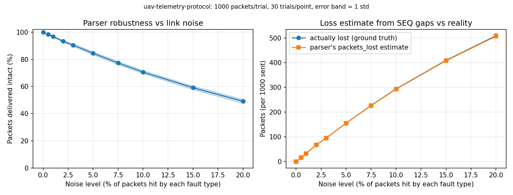
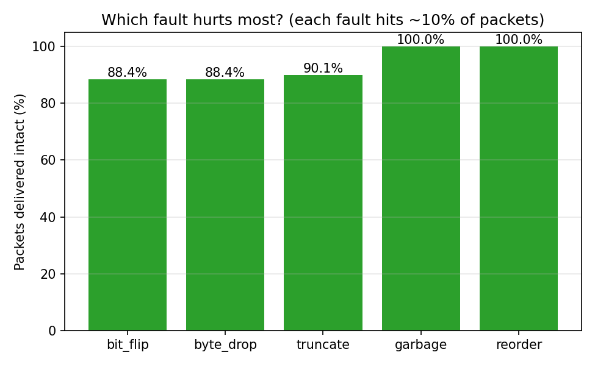

# uav-telemetry-protocol

A small C++17 library for sending and receiving UAV telemetry over a byte stream (serial port, UDP, radio link).
It defines a compact packet format with a CRC16 checksum and a streaming parser that survives noisy links:
garbage bytes, corrupted packets and truncated packets.

Built as a learning project for UAV ground-station / flight-controller communication.
No external dependencies.

## Packet format

```
+-------+-----+--------+-----+-----------+-----------+
| START | LEN | MSG_ID | SEQ | PAYLOAD   | CRC16     |
| 0xAA  | 1 B | 1 B    | 1 B | LEN bytes | 2 B (LE)  |
+-------+-----+--------+-----+-----------+-----------+
                CRC16-CCITT over: LEN, MSG_ID, SEQ, PAYLOAD
```

| MSG_ID | Name | Payload |
|---|---|---|
| 1 | HEARTBEAT | empty |
| 2 | ATTITUDE | roll, pitch, yaw (int16, centi-degrees) |
| 3 | ALT_SPEED | altitude (cm), ground speed (cm/s) |
| 4 | BATTERY | voltage (mV), percent |

Multi-byte fields are little-endian. `SEQ` increments per packet (wraps at 255) and lets the receiver estimate packet loss.

## How the parser works

A byte-by-byte state machine: `WAIT_START -> LEN -> ID -> SEQ -> PAYLOAD -> CRC_L -> CRC_H`.

- Bytes before a `0xAA` are discarded.
- If the CRC does not match, the parser drops only the false START byte and **replays the buffered bytes**
  through the state machine, so a real packet hidden inside a false candidate is still found.
- Works with any chunking of the input (one byte at a time or large blocks).

## Build and test

```bash
g++ -std=c++17 -Wall -Wextra -O2 protocol.cpp test_main.cpp -o test_protocol
./test_protocol
```

## Test results

| Test | Result |
|---|---|
| CRC16-CCITT check value (`"123456789"` = `0x29B1`) | pass |
| Encode / parse round trip | pass |
| Corrupted packet rejected | pass |
| Truncated packet followed by a valid one | pass |
| Packet loss estimated from SEQ gaps | pass |
| Reordered packets not counted as lost | pass |
| 200 packets with random garbage in between | 200 / 200 received, 4 false candidates rejected by CRC |
| Input split into tiny chunks | pass |

## Robustness benchmark (noisy link simulator)

`noisy_link.cpp` simulates a bad radio link between `encode()` and `Parser`. It injects five fault types:
bit flips, dropped bytes, truncated packets, garbage bursts and reordered packets.
`bench.cpp` sends 1000 packets per trial (30 random seeds per setting), pushes them through the link,
and checks every packet the parser delivers against the ground truth.

```bash
g++ -std=c++17 -O2 protocol.cpp noisy_link.cpp bench.cpp -o bench && ./bench
python3 plot.py   # needs matplotlib -> results.png, per_fault.png
```



| Noise level | Delivered intact | Corrupted packets accepted |
|---|---|---|
| 0 % | 100.0 % | 0 |
| 1 % | 96.8 % | 0 |
| 5 % | 84.5 % | 0 |
| 10 % | 70.6 % | 0 |
| 20 % | 49.1 % | 0 |

"Noise level" = approximate share of packets hit by each fault type (all five at once).
Across every packet in the benchmark, the parser never delivered a corrupted packet as valid.
Packets damaged on the link are dropped, never delivered wrong.

Exact numbers can differ slightly between compilers, because `std::uniform_real_distribution`
is implementation-defined. The trend and the zero false accepts do not change.

## Validated against ArduPilot SITL

The parser was also tested with telemetry from a real ArduPilot SITL flight.
MAVLink messages are converted to this protocol by `tools/mavlink_source.py` in
[mini-gcs](https://github.com/zackyhaqqi21/mini-gcs), then fed to the unmodified parser.

| Test | Result |
|---|---|
| 602 packets from the converter into the real parser | 602 ok, 0 CRC errors, 0 lost (SEQ wrap at 255 not counted as loss) |
| Full SITL flight (takeoff to 30 m, square, RTL) at 0 % noise | 2355 valid, 0 rejected, 0 lost, 0 reordered |
| Same flight with random bit flips injected into the byte stream | damaged packets rejected by CRC, horizon kept showing valid data only |

The noise in the last row is random bit flips added by the server, not a real radio link.

### Finding: the first `packets_lost` was wrong under reordering (fixed)

The benchmark compares the parser's SEQ-gap loss estimate with the real loss. With only losses
the two agreed, but with reordered packets the estimate exploded (about 23,000 estimated vs 0 real
per 1000 packets): a late packet made `seq - expected` wrap around as a `uint8_t`.

Fix: a backwards SEQ jump is now counted in `Stats::packets_reordered` instead of as loss, and the
loss it caused earlier is taken back. After the fix the estimate tracks the real loss
(e.g. 5 % noise: 155.0 estimated vs 155.5 real per 1000 packets).
Known limit: a real burst of 128 or more consecutive lost packets cannot be told apart from a
reordered packet using an 8-bit SEQ.



## Usage

```cpp
#include "protocol.hpp"
using namespace uavproto;

// Sender
std::vector<uint8_t> payload;
put_i16(payload, 150);   // roll  (1.50 deg)
put_i16(payload, -20);   // pitch
put_i16(payload, 9000);  // yaw
auto bytes = encode(MSG_ATTITUDE, /*seq=*/0, payload);

// Receiver
Parser parser([](const Packet& p) {
  // handle packet p.msg_id, p.seq, p.payload
});
parser.feed(bytes);
```

## Limitations

- A false START byte followed by a large LEN delays recognition of real packets until enough bytes arrive
  (up to 261 bytes). A real link would add a timeout.
- CRC16 detects accidental corruption, not tampering. There is no encryption or authentication.
- Lost packets are not retransmitted.
- With an 8-bit SEQ, a burst of 128 or more consecutive lost packets looks like a reordered packet.
- Altitude is an int16 in centimetres, so the maximum is 327.67 m. Higher values would overflow.

## Next steps

- [x] Validated against ArduPilot SITL via MAVLink ([mini-gcs](https://github.com/zackyhaqqi21/mini-gcs))
- [x] Ground-station dashboard ([mini-gcs](https://github.com/zackyhaqqi21/mini-gcs))
- [x] Fuzz testing with random byte streams (see the noisy link benchmark)
